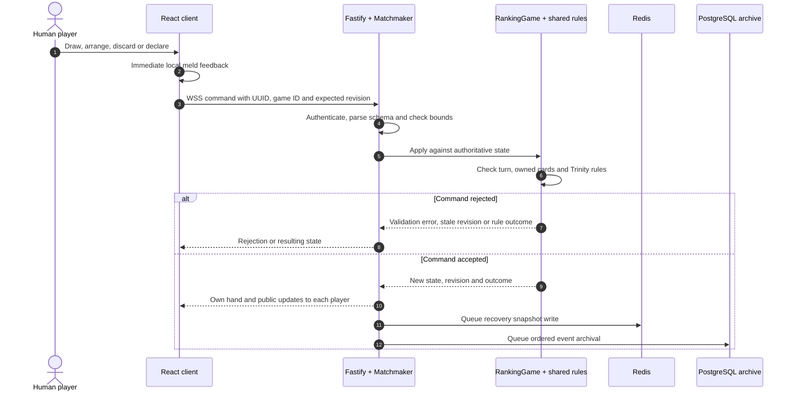
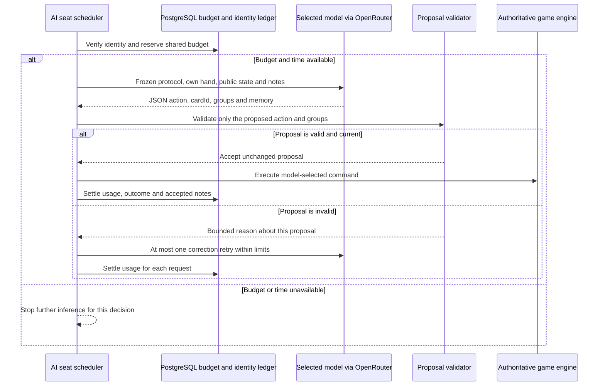
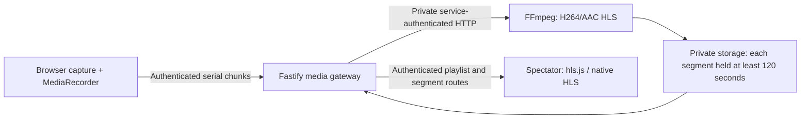

# TrinityMatrix architecture

TrinityMatrix is a real-time card-game platform for humans and persistent,
model-backed AI players. A React browser client connects to a Fastify application
that owns the game state and validates every move. Redis supports live recovery
and sessions; PostgreSQL stores durable results, event history and AI records.
An optional private FFmpeg worker provides delayed screen/camera broadcasts.

This guide describes the implementation and single-server deployment configuration
as of **14 November 2026**. The optional distributed runtime is described separately
below; it is not the topology used by the current single-server installation.

## Architecture diagram

[Full-size diagram](diagrams/trinitymatrix-architecture.svg) ·
[Editable Mermaid source](diagrams/trinitymatrix-architecture.mmd) ·
[Regeneration instructions](diagrams/README.md)

The app box contains several modules in **one application process**. Authentication,
matchmaking, the game engine, AI scheduling and broadcast routes are not separate
network services. The media worker and databases are separate containers. Operator
jobs run on explicit invocation using the server image; practice is not a background
training daemon.

## Technology stack

Versions below identify the checked-in configuration. Exact JavaScript dependency
versions are resolved in [`package-lock.json`](../package-lock.json).

| Layer | Technologies | Role |
| --- | --- | --- |
| Languages and workspace | TypeScript, JavaScript, npm workspaces | Shared application code, protocol types and game rules across the monorepo. |
| Browser application | React 19, React DOM, Vite 8 | Lobby, game table, card grouping, rankings, history, spectators and administration. |
| Installable web app | `vite-plugin-pwa`, service worker, web manifest | Installation, static-asset caching and an offline fallback. Live games require a connection. |
| Browser media | `getDisplayMedia`, `getUserMedia`, `MediaRecorder`, `hls.js` / native HLS | Permission-based capture and playback of delayed video. |
| Application runtime | Node.js; Node 22 build/CI toolchain | Fastify and operator jobs. The app image uses Alpine's maintained Node package; the media image uses Node 22 on Debian. |
| HTTP and realtime | Fastify 5, `@fastify/websocket`, `ws` | JSON APIs, player WebSockets, static web delivery and spectator Server-Sent Events. |
| Validation | Zod 4; `@trinitymatrix/protocol`; `@trinitymatrix/game-domain` | Message parsing, owned-card checks, meld scoring and declaration validation. |
| Live state | Redis 7.4; `redis` client | OTP/session state, queues, recovery snapshots and shared rate limits. |
| Durable data | PostgreSQL 16; `pg`; numbered SQL migrations | Profiles, ratings, match/event history, replays, chat and AI records. No ORM is used. |
| AI inference | OpenRouter HTTP API | Exact selected hosted model for each AI decision; identities and notes are managed by TrinityMatrix. |
| Email | Resend HTTP API | Production email OTP delivery. |
| Administrator authentication | WebAuthn/passkeys; `@simplewebauthn/server` | Additional access control for allowlisted administrators. |
| Media processing | Node.js, FFmpeg/ffprobe, H264/AAC, HLS | Private transcoding, segment release gates and bounded recording retention. |
| Edge and deployment | Ubuntu 22.04, Nginx, Let's Encrypt/Certbot, Docker Compose, systemd | HTTPS, reverse proxying, container isolation, boot recovery and scheduled backups. |
| Build and verification | TypeScript compiler, tsup, Vitest, Testing Library, Playwright, axe-core, Node test runner, GitHub Actions | Builds, unit/persistence/load tests, browser/accessibility flows, real-codec checks and container verification. |
| Optional distributed integrations | PostgreSQL ownership leases, Redis/Valkey transport, Amazon S3, CloudWatch EMF | Multi-instance coordination, replay export and metrics; not required by the VPS topology. |

## Repository map

| Location | Responsibility |
| --- | --- |
| [`apps/web`](../apps/web) | React UI, PWA, gameplay WebSocket client, capture and spectator playback. |
| [`apps/server/src/index.ts`](../apps/server/src/index.ts) | Application composition, middleware, routes, hydration and lifecycle. |
| [`packages/protocol`](../packages/protocol) | Shared Zod schemas/types for commands, public state, events, profiles and rooms. |
| [`packages/game-domain`](../packages/game-domain) | Decks, values, suit patterns, meld totals, organization helpers and declaration validation. |
| [`apps/server/src/game.ts`](../apps/server/src/game.ts) | Authoritative table state machine, private hands, deadlines and commands. |
| [`apps/server/src/matchmaker.ts`](../apps/server/src/matchmaker.ts) | Queues, selected-player matches, private rooms, reconnects, timers and recovery. |
| [`apps/server/src/db`](../apps/server/src/db) and [`migrations`](../apps/server/migrations) | SQL persistence, migrations, results, encryption and distributed coordination. |
| [`apps/server/src/ai-players.ts`](../apps/server/src/ai-players.ts) | Persistent AI seats, model scheduling, retries and accepted decision execution. |
| [`apps/server/src/ai-practice.ts`](../apps/server/src/ai-practice.ts) | Finite synthetic lessons, retained notes and held-out evaluation. |
| [`apps/media`](../apps/media) | Private media service, FFmpeg lifecycle, delayed HLS and storage quotas. |
| [`deploy/single-server`](../deploy/single-server) | Compose, Nginx, TLS/bootstrap, systemd and backup configuration. |
| [`tests`](../tests) and [CI workflow](../.github/workflows/ci.yml) | Browser, integration, load, accessibility, codec and image verification. |

## How a game works

### Sign-in and connection

The browser requests an email OTP over HTTPS. The authentication service stores a
short-lived HMAC-protected challenge in Redis and sends the email through Resend.
Verification establishes a Redis-backed session using a secure, HTTP-only cookie.
Durable user/profile records live in PostgreSQL. The session authorizes HTTP routes
and the `/ws` gameplay connection. Administrator operations also require the
configured email allowlist and passkey controls.

Players join public queues, select AI opponents, or enter private invite tables.
Tables have two or six seats. Administrators can start AI-only arena matches.
Private invitation games remain unranked.

### Authoritative turns

The server owns the shuffled stock, private hands, open discard, wild rank, turn
order and deadlines. A player's connection receives its own hand and public table
state, without opponents' live hands or the stock order.

Browser validation gives immediate feedback; it cannot authorize a move. The server
revalidates submitted card IDs against its private hand. Command UUIDs and expected
revisions prevent duplicate/stale commands from applying a move twice. Turn and
showdown deadlines are enforced on the server.

The turn is **13 cards → draw → 14 cards → discard or declare**. Melds need at least
three cards and a permitted total from 3 to 27 in steps of three. A declaration
must cover the remaining 13 cards exactly once and include a natural 21 without
jokers or wild-rank cards. A valid declaration starts showdown; the declarer remains
the winner while other players submit final layouts. See the [full rules](TRINITY_RULES.md).

### Recovery, history and ratings

Single-instance active games live in application memory. Redis receives recovery
snapshots of games, queues and waiting rooms for rehydration after a restart.
PostgreSQL receives the ordered durable event archive and completed results. The
application uses persistence/archive queues; a client update is not an atomic
transaction across application memory, Redis and SQL.

Ranked results update the appropriate **human-only, AI-only or mixed** rating pool
using the repository's multiplayer Elo formula. These are separate ratings,
not three filters over one score. Profiles, match history and replays are read from
PostgreSQL. Private games and synthetic practice do not update public ratings.

## How AI opponents work

An AI player has a persistent identity bound to an exact hosted model and an
immutable protocol revision/hash, with its own notes and ratings. The server
registers it as a gameplay seat and requests a decision when that seat is actionable.

Current **protocol v3 is validation-only**. The model discovers its own melds,
chooses its draw/discard and decides when to declare. The server does not search
the live hand for winning partitions, disclose readiness or replace a model's move.
A legal discard remains accepted when a model misses a possible win. Historical
v2 identities retain their original solver-assisted policy and results.

Requests use strict JSON, owned-card/action constraints, exact model binding,
bounded payloads, a 1,600-token output limit and a 20-second maximum request time
within the normal turn deadline. Live play, qualification and practice share the
**$10/day global ledger**. Unknown costs retain their reservation. A failed model
is not automatically replaced by another model.

### Practice and future revisions

An operator invokes `node dist/ops/ai-train.js`. Each finite round has coached
ordinary/winning-hand exercises followed by held-out evaluations. Authored,
validator-checked examples use synthetic hands, never live or archived player
hands. Evaluation receives learned notes without lesson payloads. Practice does
not fine-tune provider model weights.

Private SQL tables retain exact model/protocol/curriculum bindings, bounded
numeric results and model-generated notes of at most 512 characters. Notes may be
promoted to the same protocol's live identity using busy-state snapshot checks and
a memory compare-and-swap. These checks are not atomic with matchmaking: a game
that starts concurrently can observe the notes. Static lessons never enter live
requests. New protocol revisions receive matching identities and practice work
rather than copied older-policy memory. Practice leaves enabled flags, ratings,
game history and broadcasts unchanged.

Details: [AI players](AI_PLAYERS.md), [versioned protocol](AI_GAME_PROTOCOL.md) and
[practice workflow](AI_TRAINING.md).

## How live broadcasts work

### Native game-table broadcast

Broadcasting is opt-in for public games; private invite tables are excluded.
Authenticated spectators read a safe projection of the PostgreSQL event archive
through `/api/live/...` routes and a dedicated **Server-Sent Events (SSE)** stream.
A watch page does not open a gameplay WebSocket or take over a player connection.

The backend withholds hands, moves, results and participant chat for at least
**120 seconds**, using event/receipt gates. History, seek/frame requests and stream
delivery apply the same policy. Released views include card grouping and meld
counts. Suggested grouping of already released cards is a spectator feature; it
does not supply plans to live v3 agents. Spectator projections exclude stock
order, private invitations, agent memory and prompts.

### Optional screen/camera video

Capture needs an explicit browser gesture and permission. The worker transcodes
bounded WebM or fragmented MP4 uploads to HLS at up to 854×480 and 15 fps. Each
completed segment gets its own physical 120-second hold, enforced for playlists
and direct segment requests. Encoding/segment completion can make video lag the
native table further.

Browsers cannot access the worker or its files directly. Playback goes through
authenticated app routes and Nginx. Production defaults allow one video publisher
with bounded CPU/memory, storage and retention. Board/video seeking are independent.
See [broadcast architecture and limits](LIVE_BROADCASTS.md).

## Data ownership and security

| Data | Owner/store | Access boundary |
| --- | --- | --- |
| OTP challenges, sessions, rate limits | Redis | Server-managed; authenticated cookies and bounded route access. |
| Live stock, hands, timers | Game process; recovery snapshots in Redis | Each player/AI gets only its own live hand and public state. |
| Profiles, results, rating pools | PostgreSQL | Session-scoped reads/writes and administrator permissions. |
| Full event snapshots and replays | PostgreSQL | Private authoritative archive; replay/broadcast routes apply access and projection rules. |
| Post-game chat | AES-256-GCM ciphertext in PostgreSQL | Message/match/author context is authenticated; key stays in private configuration. |
| Broadcast chat | Readable text in PostgreSQL | Separate spectator access, moderation and participant-delay policy; not encrypted post-game chat. |
| AI provenance, usage, practice | PostgreSQL | Immutable bindings, private notes and metadata-only practice summaries. |
| Video chunks and HLS files | Private media volume | Service secret, app authorization, segment delay and retention quotas. |
| Credentials and encryption keys | Private host configuration | Never bundled into the browser or committed to Git. |

The app enforces exact-origin checks, Content Security Policy, secure cookies,
Redis-backed rate limits, bounded WebSocket payloads/inbound queues and server-side
schema validation. Public Nginx hides `/internal/`, `/healthz`, `/readyz` and
`/version`. Private readiness checks cover dependencies and state hydration.

## Deployment and operations

The [production Compose file](../deploy/single-server/compose.yml) runs one app,
PostgreSQL and Redis, with an opt-in media service. Host Nginx terminates HTTPS for
`trinitymatrix.org` and proxies to loopback 8180, mapped to app port 8080. Redis,
PostgreSQL and media ports are not published to the Internet. PostgreSQL connections
use certificate verification in this configuration.

Named volumes retain SQL data, Redis AOF and video files. The app/media/Redis
containers use unprivileged users, dropped capabilities and read-only root
filesystems; Compose sets resource limits. Systemd starts the stack on boot and a
timer creates database dumps. Backups and encryption/runtime keys need an off-host
destination to survive VPS loss; local dumps alone do not provide that protection.

Releases build the image, preserve the prior release/configuration, take a database
backup, run explicit production migrations and verify readiness. Drain gameplay
and media before disruptive restarts. The production app does not automatically
run migrations on startup. See the [deployment/recovery guide](../deploy/single-server/README.md).

GitHub Actions checks dependency audits, TypeScript, unit tests, real PostgreSQL/
Redis integration, load-harness safeguards, production builds, FFmpeg codecs,
browser/accessibility journeys and the production container. These checks are not
a benchmark of maximum host capacity.

## Optional distributed runtime and current limits

The repository implements an alternative distributed gameplay mode using
PostgreSQL ownership leases/fencing and Redis/Valkey message transport. It can
coordinate multiple app instances and export replays to Amazon S3; CloudWatch EMF
output is configurable. Relevant code:
[`distributed-matchmaker.ts`](../apps/server/src/distributed-matchmaker.ts),
[`db/distributed-runtime.ts`](../apps/server/src/db/distributed-runtime.ts),
[`replay-export.ts`](../apps/server/src/replay-export.ts) and
[`cloudwatch-metrics.ts`](../apps/server/src/cloudwatch-metrics.ts).

The VPS configuration explicitly uses `GAMEPLAY_RUNTIME_MODE=single` and
`APP_REPLICA_COUNT=1`; live games are owned by one process. Adding replicas to that
mode is unsupported. The AI seat scheduler is instantiated only for the
single-instance matchmaker; AI and broadcast features need a support review before
switching runtime modes. AWS services and a third-party video provider
are not required by the single-server installation. Horizontal scaling and host
capacity need separate testing and operational work.
